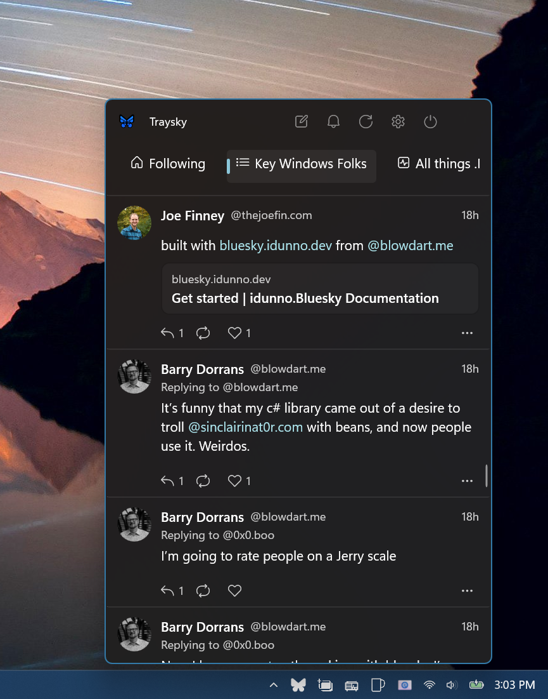

<p align="center">
  
</p>
<h1 align="center">Traysky</h1>
<p align="center">Bluesky in your Windows system tray</p>

Traysky is a tiny Bluesky client that lives in the tray. Click the butterfly and a flyout opens
with your **Home** timeline, your **Notifications**, and a compose box. The icon shows a dot when
you have unread notifications, and Windows toasts tell you about mentions and replies. That's it —
the fastest way to post, the calmest way to keep up.

Built with .NET 10, WinUI 3, the Windows App SDK and [idunno.Bluesky](https://bluesky.idunno.dev/),
on the tray plumbing of [Traydio](https://github.com/TheJoeFin/Traydio).

<p align="center">
  
</p>

## Features

- 🦋 Tray icon with an unread dot; theme-aware when signed out
- 🏠 Home timeline with rich text (links, mentions, hashtags), images, link cards and quotes
- 🔔 Notifications grouped like the official app ("A, B and 3 others liked your post")
- ✍️ Compose, reply and quote from the flyout — Ctrl+Enter to post, 300-grapheme counter
- ❤️ Like and repost with instant feedback
- 🔐 Sign in through your browser (OAuth), or with an [app password](https://bsky.app/settings/app-passwords);
  the refresh token is stored DPAPI-encrypted, never your password
- Browser sessions require sign-in again after Bluesky's two-week session limit; expired sessions return to the sign-in page
- ⚙️ Configurable tray clicks, poll interval, toast types, start with Windows
- ⌨️ Ctrl+1 / Ctrl+2 tabs, Ctrl+N compose, Ctrl+R refresh, Esc to hide

## Install and automatic updates

For GitHub releases, download [Traysky.appinstaller](https://github.com/TheJoeFin/traysky/releases/latest/download/Traysky.appinstaller)
and open it with Windows App Installer. This link becomes available when the first release
containing the feed is published. Windows selects x64 or ARM64, installs the matching Windows
App Runtime if needed, and checks for updates silently on launch and in the background.
An update may wait until Traysky exits; hiding the flyout does not exit the tray app.

Existing GitHub installs without an update feed need to open the `.appinstaller` once to enroll.
This feed is for GitHub sideloads, not Microsoft Store installs, and uses the Windows 11
App Installer 2021 schema. Direct bundle installs can also enroll through the embedded feed.

## How to build

- Install [Visual Studio 2026](https://visualstudio.microsoft.com/) with the **.NET desktop development**
  and **Windows application development** (Windows App SDK) workloads, or the .NET 10 SDK.
- Open `Traysky.slnx` and press F5 (Local Machine), or:

```
dotnet build Traysky.slnx -p:Platform=x64
dotnet test Traysky.Tests/Traysky.Tests.csproj -p:Platform=x64
```

### Previewing without an account

Debug builds can show sample data: create an empty `preview.flag` file in the package's
`LocalState` folder (`%LOCALAPPDATA%\Packages\40087JoeFinApps.Traysky_*\LocalState\`) and launch.

### Releasing on GitHub

From a PowerShell session with the maintainer's `sign-msix` function loaded, run
`.\build-msix-for-gh.ps1` at the repository root (the copy in `Traysky` forwards to it).
The script needs the .NET 10 SDK, Windows SDK MakeAppx, the x64/ARM64 publish profiles,
and authenticated `gh`. Use the same signing identity for every release.

Bump `Identity.Version` in `Traysky\Package.appxmanifest` above the last published version,
then commit and push before running. The script builds both architectures, embeds an identical
update feed in each, creates and signs one `.msixbundle`, and verifies its identities,
architectures, feed, block maps and framework dependencies before creating a **draft** release.
Publish the draft as a non-pre-release to advance the stable update feed, without changing its
tag, then run `.\build-msix-for-gh.ps1 -VerifyPublished` to check that the stable
`latest/download` link serves this version and every address in the feed downloads. `-SkipRelease`
builds and signs locally without creating a tag or release; `-Prerelease` does not advance
the stable feed.

The draft includes all four generated assets from `Traysky\AppPackages\GitHub\<version>-gh`:
the `.msixbundle`, `Traysky.appinstaller`, and the x64/ARM64 Microsoft Windows App Runtime
framework MSIX files. Do not re-sign Microsoft's packages. Every stable release must retain
the same feed filename; its bundle and dependency URLs target that release's versioned assets.
The script restores the source manifest byte-for-byte even if publishing fails, so ordinary
builds and Store packaging do not acquire the GitHub feed.

Windows App SDK components and the unused WebView2 exclusion are pinned to the versions
previously restored by the metapackage. Update these references explicitly when upgrading the SDK;
AI, ML, Search, Widgets and DWrite are omitted because Traysky does not use their APIs.
CommunityToolkit's legacy SDK dependency is explicitly excluded so its older build targets and
binaries cannot mix with the component packages.

## Project layout

See [PLAN.md](PLAN.md) for the architecture, decisions and milestones. In short:

| Folder | What |
|---|---|
| `Traysky/Services` | `BlueskySessionService` (the one agent), `NotificationPollService`, `SessionStore` (DPAPI), `FeedMapper`, plus pure `*Policy` classes |
| `Traysky/ViewModels` | Timeline, Notifications, Compose, Login, Settings, Shell |
| `Traysky/Controls` | `TrayPopupWindow` (ported from Traydio), `PostCard`, `EmbedPresenter`, `ComposeBox` |
| `Traysky/Pages` | Shell, Login, Timeline, Notifications, Settings |
| `Traysky.Tests` | MSTest over the pure policy files, linked in without WinUI |

## Packages

- [idunno.Bluesky](https://www.nuget.org/packages/idunno.Bluesky) — AT Protocol / Bluesky client
- [CommunityToolkit.Mvvm](https://www.nuget.org/packages/CommunityToolkit.Mvvm), [CommunityToolkit.WinUI.Controls.Segmented](https://www.nuget.org/packages/CommunityToolkit.WinUI.Controls.Segmented), [CommunityToolkit.WinUI.Animations](https://www.nuget.org/packages/CommunityToolkit.WinUI.Animations)
- [Microsoft.WindowsAppSDK](https://www.nuget.org/packages/Microsoft.WindowsAppSDK), [WinUIEx](https://www.nuget.org/packages/WinUIEx), [Microsoft.Windows.CsWin32](https://www.nuget.org/packages/Microsoft.Windows.CsWin32)

## License

MIT — see [LICENSE.txt](LICENSE.txt).
